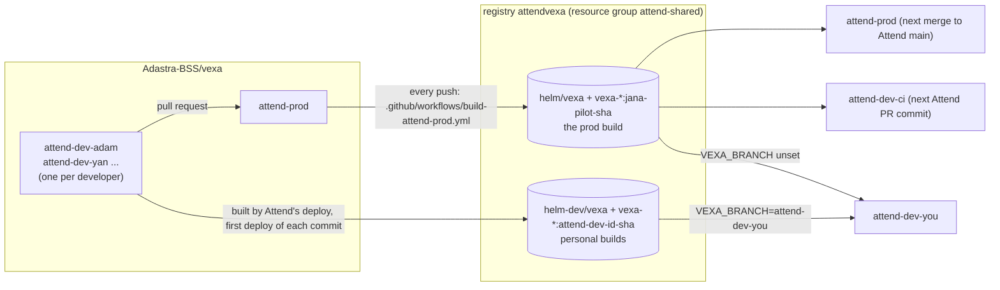

# Developing this fork

How the Attend team works on `Adastra-BSS/vexa`: what deploys what, how to run your own Vexa branch
on your own Attend dev stack, and how a change reaches prod. For *why* the fork exists and what it
changes, see [`FORK.md`](../FORK.md).

## The picture



| Branch | Who changes it | What runs it |
|---|---|---|
| `attend-prod` | pull requests only | Every push is built and published as the prod build. Attend prod deploys it on the next merge to Attend `main`; `attend-dev-ci` on the next Attend PR commit; every dev stack that does not ask for something else. |
| `attend-dev-<id>` | its owner | Only the owner's Attend dev stack, and only when that stack's `.env` says `VEXA_BRANCH=attend-dev-<id>`. |
| `main` | nobody, by hand | Upstream Vexa (`Vexa-ai/vexa`) as forked; the base the fork's changes sit on. |

`<id>` is the same suffix as your Attend dev stack: `attend-dev-adam` for `USER_SUFFIX=adam`.
Lowercase letters, digits and dashes only.

The prod build is still *named* `jana-pilot-<sha>` in the registry. That is the build's name, kept
from before the branch was renamed, and every Attend deploy resolves it; it does not follow the
branch name. See [`deploy/acr/README.md`](../deploy/acr/README.md).

## Before you start

You need:

- **GitHub:** write access to `Adastra-BSS/vexa` and `Adastra-BSS/Attend`, and `gh` logged in.
- **Azure:** `az login` into the Attend subscription, with Contributor on the registry `attendvexa`
  (personal builds run as you), and your own Attend dev stack, resource group `attend-dev-<id>`.
  Attend's `README.md` ("Your first dev stack") creates it.
- **Tools:** `git`, `az`, `gh`, `kubectl`, `helm`. Docker only if you run Vexa locally.
- **Both checkouts**, e.g. `~/Code/vexa` (this fork) and `~/Code/Attend`.

## First-time setup

```bash
# the fork; remote "origin" is Adastra-BSS/vexa
git clone https://github.com/Adastra-BSS/vexa.git ~/Code/vexa
cd ~/Code/vexa
git switch -c attend-dev-<id> origin/attend-prod
git push -u origin attend-dev-<id>
```

In your Attend checkout, add to your local `.env` (never committed):

```bash
VEXA_BRANCH=attend-dev-<id>    # unset, empty or attend-prod: the prod build
```

Already had a clone from before the rename? Re-point it once:

```bash
git branch -m jana-pilot attend-prod
git fetch origin
git branch -u origin/attend-prod attend-prod
git remote set-head origin -a
```

Do not push from an old local `jana-pilot`.

## The development loop

1. **Work on your branch.** For anything bigger than one change, branch `feat/...` off your
   `attend-dev-<id>` and merge it in when you want to try it on your stack.
2. **Try it locally first** where you can:
   - the whole Vexa stack: `make -C deploy/compose dev` (see [`deploy/compose/README.md`](../deploy/compose/README.md));
   - Attend against a local Vexa: build Vexa Lite from your checkout (`make -C deploy/lite build`)
     and run Attend's `make capture-local-up` (Attend `docs/local-stack.md`).
3. **Push.** The deploy builds the commit GitHub has, not your local checkout.
4. **Deploy to your stack**, from your Attend checkout:

   ```bash
   make deploy-dev USER_SUFFIX=<id>       # only when Attend's own code changed since your last one
   make deploy-aks-dev USER_SUFFIX=<id>
   ```

   The first deploy of a new commit builds Vexa in the registry first (about 7 minutes), then
   installs it. Redeploying the same commit reuses that build. You should see:

   ```
   [deploy-aks] building attend-dev-<id> @ <sha7> in attendvexa - the first deploy of this commit waits for the whole build
   [deploy-aks] deploying fork branch attend-dev-<id>, commit <sha> (chart helm-dev/vexa:0.12.1-attend-dev-<id>-<sha>)
   ```

5. **Test with a real meeting.** Put `[dev-<id>]` in the meeting subject; your stack's bot joins as
   "Attend Notetaker - dev-<id>". Dev stacks leave a call after **90 s with no audio**
   (`alone_silence_seconds` in Attend's `config/dev.yaml`; prod waits 15 min), so speak, or set
   `VEXA_ALONE_SILENCE_SECONDS=900` in your `.env` for quiet tests.
6. **Back to the prod build:** remove or empty `VEXA_BRANCH` and deploy again.

Run `make aks-stop USER_SUFFIX=<id>` when you are done for the day; a stopped cluster costs no
compute.

## Getting a change to prod

1. **Open a pull request** from `attend-dev-<id>` (or a `feat/...` branch) into `attend-prod`:

   ```bash
   gh pr create --repo Adastra-BSS/vexa --base attend-prod --head attend-dev-<id>
   ```

   Pass `--repo Adastra-BSS/vexa`: your clone may also know upstream `Vexa-ai/vexa`, and a PR must
   never go there by accident.
2. **The PR description** follows the template. In *Contribution rights*, tick the path that is
   true for you (for Adastra work, normally *Employer/client*), and sign every commit:
   `git commit --signoff`.
3. **Checks:** `gates` must be green. `docs-current` asks for a change under `docs/` or the
   `docs: none` label. Upstream's sign-off checks (`merge-card`, `contribution-rights`, the
   welcome comment) are removed from this fork: nobody here runs that review process.
4. **Keep it compatible with today's Attend `main`.** A merge into `attend-prod` is built at once
   and reaches prod at the next merge to Attend `main`, *by anyone, for any reason*. New behaviour
   goes in off by default, or behind a setting Attend passes in.
5. **After the merge, re-sync your branch** before building on it again:

   ```bash
   git fetch origin
   git reset --hard origin/attend-prod
   git push --force-with-lease origin attend-dev-<id>
   ```

A change that needs both repos: merge the Vexa part first (switched off), then the Attend PR that
uses it.

## Where to look

| What | Where |
|---|---|
| Which Vexa a stack runs | `helm -n vexa list` (chart `vexa-0.12.1-<channel>-<sha>`) |
| Prod builds available | `az acr repository show-tags -n attendvexa --repository helm/vexa --orderby time_desc --top 3 -o table` |
| Your personal builds | `az acr repository show-tags -n attendvexa --repository helm-dev/vexa -o table` |
| Prod build runs | GitHub, Actions, "Build attend-prod" |
| Live logs on your stack | `make kube-context USER_SUFFIX=<id>`, then `kubectl -n vexa logs ...`; one bot pod per meeting, `vexa-mtg-<meeting id>-<hex>` |
| Logs after the pod is gone | the Log Analytics workspace in `attend-dev-<id>`, table `ContainerLogV2` (Attend `docs/infrastructure.md`, "Where the logs are") |

## When something goes wrong

| Symptom | Meaning |
|---|---|
| `... predates per-branch builds. Re-sync it onto attend-prod and push.` | Your branch was cut before personal builds existed; building it would publish it as the prod build, so the deploy refuses. Re-sync (above). |
| `the fork Adastra-BSS/vexa has no branch attend-dev-<id>` | Push your branch, or fix `VEXA_BRANCH`. |
| `VEXA_BRANCH must be empty, attend-prod or attend-dev-<id>` | A typo or an uppercase letter in `.env`. |
| `capture-service:<key> is not in <registry>` | Attend's own image for your current Attend source is not built: `make deploy-dev USER_SUFFIX=<id>`, then deploy again. |
| `LLM Gateway unreachable from this cluster (egress <ip>)` | Your stack's outbound IP is not on the LLM Gateway allowlist; meetings still record and transcribe, but publish no summary. Ask for the IP to be allowlisted. |
| The bot leaves a quiet meeting after about 2 minutes | The dev silence window (90 s), not a crash. See step 5 of the loop. |

## Rules

- **The fork is public.** Everything you push, including personal branches, is readable by anyone.
  No secrets, customer data or internal notes, ever.
- **`attend-prod` changes only through pull requests.**
- **Your `attend-dev-<id>` is yours.** Do not push to someone else's.
- **Prod and `attend-dev-ci` ignore `VEXA_BRANCH`.** Leaving it in your `.env` is safe.
- Personal builds are deleted from the registry after 14 days and rebuilt by your next deploy.
